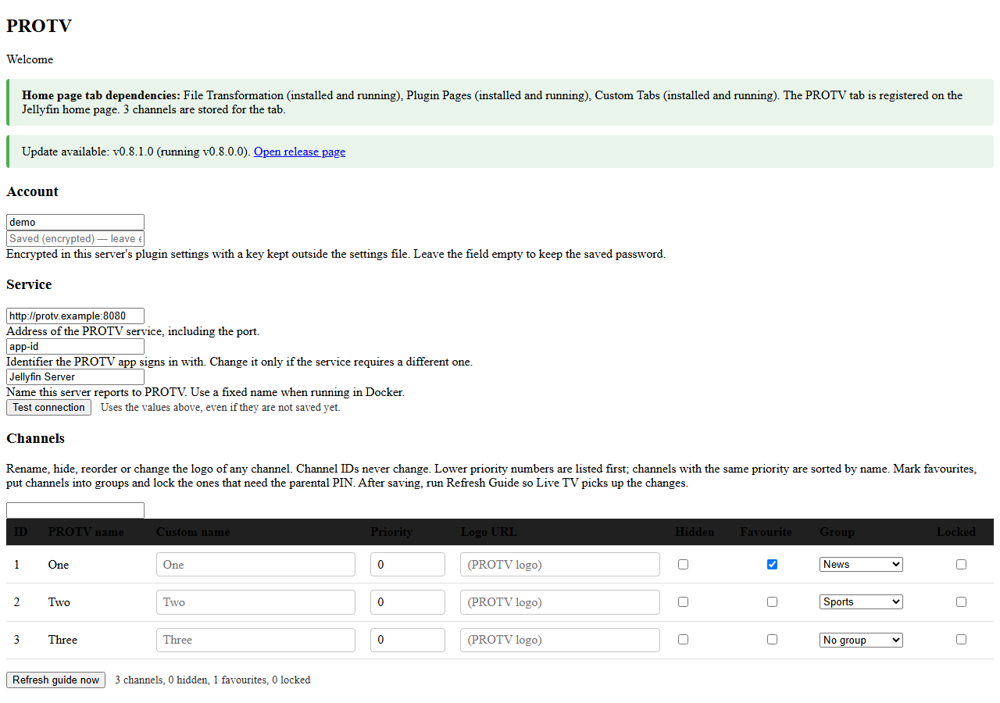
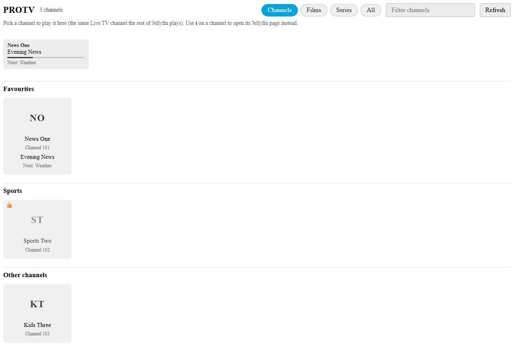

# PROTV for Jellyfin

Watch your PROTV channels, films and series inside Jellyfin, with a program guide, a management
dashboard, search, parental locks and a PROTV tab on the Jellyfin home page.

> [!WARNING]
> **Early development. Not a final version.** The plugin changes parts of your Jellyfin
> configuration (see [What the plugin modifies](#what-the-plugin-modifies)) and can misbehave.
> **Back up your Jellyfin configuration and data before installing it.** Use it at your own risk.
>
> **Made with AI.** This plugin was developed with the help of AI (Claude, by Anthropic). AI-written
> code can contain mistakes, and it has only had limited testing on real servers.





*Screenshots use demo data. They show the dashboard and the home page tab with the English interface.*

## Requirements

| | |
|---|---|
| **Subscription** | A valid, active PROTV account. The plugin includes no channels, accounts or content. |
| **Location** | **Works in Syria only.** The PROTV service is only available there. |
| **Network** | The server must reach the PROTV service (default `http://10.1.0.8:82`) and receive its multicast streams (UDP `225.2.0.x`, port `1234`). |
| **Jellyfin** | **12.x** (built against the Jellyfin 12.0.0 plugin packages, .NET 10). It does not load on 10.x or 11.x. |
| **Companion plugins** | Plugin Pages, File Transformation and Custom Tabs (see below). |

## Required companion plugins

PROTV draws its dashboard entry and its home page tab through three plugins by **IAmParadox27**. By
default **PROTV switches itself off (no tuner, no guide, no pages) when one of them is missing.**

| Plugin | Author | Repository | Used for |
|---|---|---|---|
| File Transformation | IAmParadox27 | [jellyfin-plugin-file-transformation](https://github.com/IAmParadox27/jellyfin-plugin-file-transformation) | Web client patches the other two need |
| Plugin Pages | IAmParadox27 | [jellyfin-plugin-pages](https://github.com/IAmParadox27/jellyfin-plugin-pages) | The PROTV entry in the sidebar |
| Custom Tabs | IAmParadox27 | [jellyfin-plugin-custom-tabs](https://github.com/IAmParadox27/jellyfin-plugin-custom-tabs) | The PROTV tab on the home page |

Install them first: **Dashboard > Plugins > Repositories > Add**
`https://www.iamparadox.dev/jellyfin/plugins/manifest.json`, then install File Transformation, Plugin
Pages and Custom Tabs from the **Catalog**, in that order, and restart Jellyfin. If one is not in the
catalog, follow the install instructions in its repository.

The switch is the `RequireCompanionPlugins` setting (default `true`). Turn it off only when you want
Live TV without the sidebar entry and home page tab.

## Installation

### From the plugin catalog

1. **Dashboard > Plugins > Repositories > Add** and enter:
   `https://raw.githubusercontent.com/YOUR_GITHUB_USERNAME/YOUR_REPO/main/manifest.json`
2. Open the **Catalog**, install **PROTV**, and restart Jellyfin.

### By hand

1. Download `PROTV_<version>.zip` from the [releases](../../releases) and extract `PROTV.Plugin.dll`.
2. Put it in `<config>/plugins/PROTV/` (Docker image: `/config/plugins/PROTV/`; Windows:
   `%ProgramData%\Jellyfin\Server\plugins\PROTV\`). Make sure the Jellyfin user can read it.
3. Restart Jellyfin.

### Docker

PROTV streams use multicast, which does not cross Docker's default bridge network. Use host networking:

```yaml
services:
  jellyfin:
    image: jellyfin/jellyfin:12.0   # a pinned 12.x tag
    network_mode: host              # required for multicast
```

Wired connections are strongly recommended: multicast over Wi-Fi is unreliable. With several network
cards, set the **Multicast network interface** on the dashboard.

## Getting started

1. Open **PROTV** in the Jellyfin sidebar (or **Dashboard > PROTV**).
2. Enter your PROTV **username and password**, press **Test connection**, then **Save**.
3. **Dashboard > Live TV > Tuner Devices**: add the **PROTV** tuner. Under **TV Guide Data Providers**
   add **PROTV EPG** if you want program data.
4. Press **Refresh guide now** on the PROTV page. Your channels appear in Live TV.
5. Watch from **Live TV**, or open the **PROTV** tab on the home page and tap a channel.

The password box is deliberately empty after saving: the password is encrypted on the server, and a
blank box means "keep the saved one". Type a new password only when you want to replace it.

## Features

**Live TV**

- PROTV tuner with channel logos and a built-in channel-to-stream table.
- Program guide through the **PROTV EPG** provider.
- An **On now** row and now / next lines on the home page tab.
- **Channel health check:** probes each stream every six hours (and on demand) and greys out a channel
  the last check could not get data for. The result is kept in memory; it never changes your settings.
- **Favourites and groups:** mark channels as favourites and put them in named groups (News, Sports,
  Kids, …). The tab shows Favourites first, then the groups in your order, then the remaining channels.
- **Parental locks:** tick **Locked** on chosen channels, set a PIN, and the tab asks for it before
  playing those channels. Each Jellyfin user unlocks their own session for twelve hours.
- Several viewers can watch the same channel at once; a clear "channel not working" error when a
  channel has no stream address.

**Films and series (VOD)**

- Two libraries the plugin creates and keeps up to date: **PROTV VOD** (films) and **PROTV VOD Series**.
- Every title is a small `.strm` file plus `.nfo` metadata, poster and subtitles, so it plays like any
  other library on web, mobile and TV apps.
- **Genres:** the sync asks PROTV for a title's categories and writes them into `movie.nfo` /
  `tvshow.nfo`, so Jellyfin's genre filters and collections work. Existing NFOs that have no
  `<genre>` are repaired one by one on the next sync; the rest of the library is not rewritten.
- **Sync status on the dashboard:** last run, film / series / episode / subtitle counts, disk used,
  download budget and the last error, plus a **Sync now** button that shows live counters.
- The scheduled task **Sync PROTV VOD library** (category PROTV) runs on an interval.
- A disk budget for posters and subtitles, and the sync steps aside while somebody is watching.
- Titles PROTV no longer lists are removed only after a complete sync that listed at least half of
  what the previous complete run saw (can be switched off). A short or failed answer never empties
  the library.
- **Search across live channels, films and series** in one box in the **All** view of the tab.

**Dashboard**

- Account, service address and device name, with a **Test connection** button. A blank password reuses
  the saved one only when the username still matches.
- **Channels:** rename, hide, reorder or change the logo of any channel; mark favourites, assign
  groups and lock channels.
- **Channel groups:** add, rename, reorder and delete groups. Group names are shown exactly as typed.
- **Appearance:** page heading, welcome message, menu label, icon and interface language.
- **Device and streaming:** device IP / MAC, router MAC, multicast network interface, stream analysis
  time.
- **Home page tab** and **VOD** settings.
- **Settings backup and restore:** downloads or restores a JSON file with the visible settings,
  channel overrides and groups. Passwords and stream-signing secrets are deliberately left out.
- **Diagnostics:** one button creates a report to paste into a bug report. Passwords, usernames,
  tokens and the VOD signing secret are removed, and IP addresses are shortened.
- **Update notice:** set a public GitHub `owner/repo` under **Update repository** and the page checks
  its latest release (cached for six hours). Leave it empty to hide the notice.

**Arabic interface**

Choose **Automatic**, **English** or **العربية** under **Interface language**. Arabic makes the
dashboard and the home page tab right-to-left and translates the interface. Channel names, group
names, film titles and other values are never translated. The dashboard setting is passed to the tab;
**Automatic** follows each browser's language. See also [README.ar.md](README.ar.md).

**Reliability**

- The PROTV client retries transient network errors and re-authenticates once when a token expires.
- If a refresh fails, the tab keeps the last channel list and shows a short "PROTV is unavailable"
  banner instead of an empty page.
- A failed channel health check never blocks playback; it only adds a visual warning.

## Recording

Jellyfin's DVR uses the same Live TV tuner and stream path as playback. Use **Dashboard > Live TV >
Recordings** (or the record button in the guide) normally. Notes for multicast sources:

- The server joins the multicast group for each recording, just as it does for playback, so one
  recording does not use up a "tuner" for other viewers.
- A recording is only as good as the multicast path. If the server cannot receive the group, both
  playback and recording fail; check the health page and the **Multicast network interface** setting.
- Jellyfin records to its own recording folder and transcodes when the client requests it. Make sure
  that folder has enough space, especially for series recordings.
- Recording support has not been tested on every Jellyfin client. If a recording starts but stays
  empty, check the Jellyfin log for the tuner and try a single recording before scheduling a series.

## Settings that are not on the dashboard

Most settings are on the PROTV dashboard. These remain in
`<config>/plugins/configurations/PROTV.Plugin.xml`; edit it while Jellyfin is stopped.

| Setting | Default | Meaning |
|---|---|---|
| `RequireCompanionPlugins` | `true` | Switch PROTV off when a companion plugin is missing. |
| `VodRemoveDeletedTitles` | `true` | Remove titles PROTV no longer lists after a complete sync. |
| `VodStreamSecret` | (generated) | Secret that signs the VOD links. Encrypted with the same server-local key and never included in backups. |
| `StreamAnalyzeDurationMs` | `1500` | Lower starts playback faster; too low can miss audio tracks. `0` = Jellyfin default. |

## Security and secrets

- **The PROTV password and the VOD signing secret are encrypted** with AES-GCM before Jellyfin writes
  `PROTV.Plugin.xml`. The random key lives in `<data>/protv/secret.key`, outside the plugin
  configuration folder. This keeps them out of screenshots, casual config copies and backups that
  only contain the XML; it is **not** protection against someone who can read the whole Jellyfin data
  folder.
- Values written by an older build are migrated to the encrypted form on the first start. If the
  server cannot create `secret.key`, the dashboard shows a warning and saving settings fails rather
  than writing the password or signing secret in clear text.
- Losing `secret.key` makes the saved password unreadable. Re-enter it on the dashboard; do not copy
  only the XML to another server and expect the password to work.
- The **parental PIN** is stored as a salted PBKDF2-SHA256 hash in `<data>/protv/parental.json`,
  never in the plugin XML. Unlock tokens are HMAC-signed, bound to one Jellyfin user, sent in the
  `X-PROTV-Unlock` header rather than a URL, and expire after twelve hours.
- Diagnostics remove the password, username, tokens and `VodStreamSecret` before showing a report,
  and shorten IP addresses. **Still read a report before posting it.**
- Settings backups leave out the password, the stream-signing secret and the parental PIN.
- `PROTV.Plugin.xml` and `secret.key` are still sensitive. Never post either, even though the secrets
  inside the XML are encrypted.
- The plugin never writes PROTV credentials, Jellyfin tokens or signed stream URLs to the log.

## What the plugin modifies

- Its own settings file `plugins/configurations/PROTV.Plugin.xml` (password encrypted; other secrets
  as described above), the encryption key in `<data>/protv/secret.key` and the parental PIN file in
  `<data>/protv/parental.json`.
- The Custom Tabs configuration (it adds, updates and removes its own tab) and the Plugin Pages entry.
- Live TV: it adds a tuner and a guide provider. Uninstalling from the dashboard removes them from your
  Live TV settings and queues a guide refresh, which can remove the PROTV channels from your library.
- The VOD libraries and the `protv-vod` folder (it creates and, for titles PROTV removed, deletes files there).

## Troubleshooting

1. Open the PROTV page, press **Create diagnostic report** and read it. It lists versions, companion
   plugin status, settings (without secrets), the VOD state and recent warnings.
2. **Test connection** tells you whether the login and the network path work.
3. Nothing happens after installing: look for `PROTV companion plugins` in the Jellyfin log.
4. PROTV disabled itself and the page is gone: install the missing plugins and restart, or stop Jellyfin
   and set `RequireCompanionPlugins` to `false`.
5. The tab says PROTV is unavailable: the last channel list is still usable; press **Refresh** when the
   service returns. Check the Jellyfin log for the HTTP status.
6. Channels listed but no picture: check the **Channel health** section, then make sure multicast reaches
   the server (`tcpdump -i <interface> udp port 1234`) and that Docker uses host networking.
7. A channel is greyed out: the health check could not get data for it. It may still play; the check is
   advisory and runs again every six hours.
8. Films have no genres: run the VOD sync once after updating. The sync only fetches categories when a
   title's NFO is missing a `<genre>`; if PROTV's detail endpoint returns none, the title stays without
   genres and the next sync tries again.
9. Old VOD items stop playing after an update: run **Sync PROTV VOD library** once.
10. The saved password stopped working after moving servers: enter it again; the encryption key did not
    move with the XML.

Found a bug? [Open an issue](../../issues/new/choose) and attach the diagnostic report.
**Never post your password, `PROTV.Plugin.xml` or `secret.key`.** For security problems see
[SECURITY.md](SECURITY.md).

## Known limitations

- Early development: expect bugs and changes between versions.
- Works in Syria only and only with a valid PROTV subscription.
- Multicast does not work over Docker's bridge network and is unreliable over Wi-Fi.
- The parental lock is enforced by the PROTV tab, not by Jellyfin's Live TV endpoints. Use Jellyfin's
  per-user Live TV permissions when you need a hard access control. Per-user ratings are not
  implemented; locks are per channel and the PIN is shared by the server.
- Changes to the home page tab settings or the sidebar label need a Jellyfin restart.
- Deleting the plugin folder by hand does not run the uninstall cleanup: remove the PROTV tuner under
  Live TV and run **Refresh Guide** yourself.
- Arabic translation covers the interface; channel, group and programme names are values and stay as
  PROTV wrote them.
- Recording is provided through Jellyfin's normal DVR path and has not been tested on every client.
- Only tested on Jellyfin 12.x.

## Building from source

```
dotnet build -c Release
```

The output is `bin/Release/net10.0/PROTV.Plugin.dll`. The project targets .NET 10 and the Jellyfin
12.0.0 packages. `make-release.ps1` builds the release zip and fills in `manifest.json`.

The pure-logic tests are an xunit project in `tests/PROTV.Plugin.Tests`:

```
dotnet test tests/PROTV.Plugin.Tests/PROTV.Plugin.Tests.csproj -c Release
```

They cover channel sorting and overrides, password encryption, parental PIN hashing and token signing,
version/repository parsing, EPG parsing and server-offset conversion, VOD sweep safeguards and genre
preservation, and the live-stream contracts.

## Releasing

Tag a version and GitHub Actions does the rest:

```
git tag v0.8.0
git push origin v0.8.0
```

`.github/workflows/release.yml` builds the plugin with the tag as its version (the version Jellyfin
shows comes from `PROTV.Plugin.csproj`), packs `PROTV_<version>.zip` holding `PROTV.Plugin.dll`,
publishes it as a GitHub release, and writes the release's MD5 into `manifest.json` so a plugin
catalog can offer the update. `.github/workflows/build.yml` compiles every push and pull request and
runs the tests in `tests/`.

To do the same by hand on Windows, run `.\make-release.ps1 -GitHubUser <you> -Repo <repo> -Version 0.8.0`
and upload the zip it prints.

## Credits

- **IAmParadox27** for Plugin Pages, File Transformation and Custom Tabs.
- The **Jellyfin** project.

## Disclaimer

An independent community project, written with the help of AI. It is **not affiliated with, endorsed by
or supported by PROTV, Jellyfin or the authors of the companion plugins.** It does not provide, unlock
or redistribute content and does not replace a PROTV subscription. The software is provided "as is",
without warranty of any kind. You are responsible for backing up your server and for using it within
the terms of your PROTV subscription.
